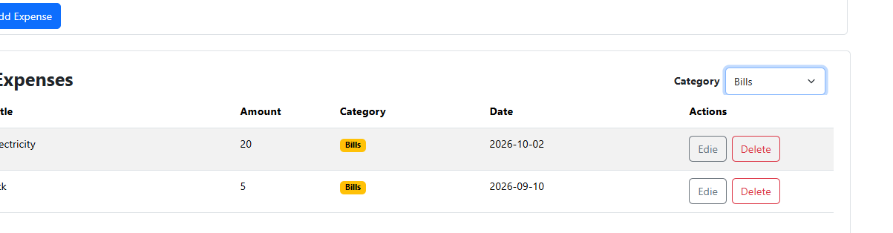
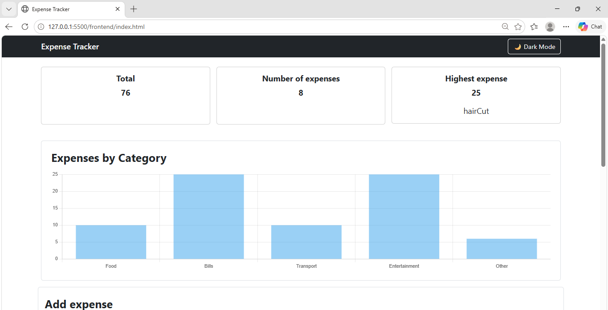
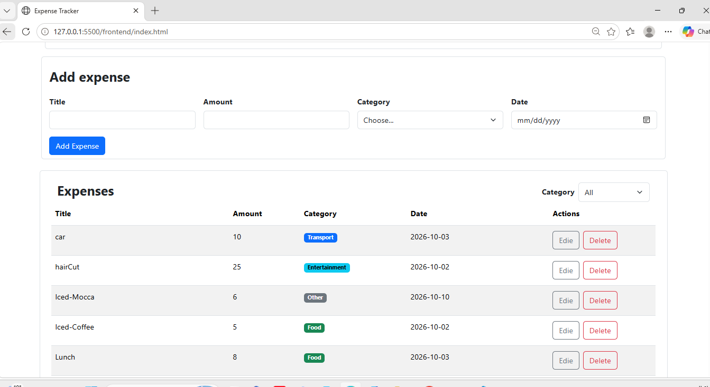
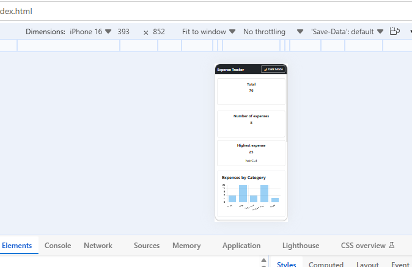

# Expense Tracker

Expense Tracker is a full-stack web application for managing daily expenses. It allows users to add, view, edit, delete, and filter expenses, while displaying summary information such as the total amount, number of expenses, and highest expense.

## How to Run

### Backend

1. Make sure Node.js and PostgreSQL are installed.

2. Open the `Backend` folder in VS Code.

3. Create a PostgreSQL database named:

```text
expense_tracker
```

4. Open `schema.sql` and run it in PostgreSQL to create the required tables.

5. Create a `.env` file inside the `Backend` folder and add the database configuration:

```env
DB_HOST=localhost
DB_PORT=5432
DB_USER=your_username
DB_PASSWORD=your_password
DB_NAME=expense_tracker
```

6. Install the backend dependencies:

```bash
npm install
```

7. Start the backend server:

```bash
npm start
```

The backend API will run on:

```text
http://localhost:3000
```

### Frontend

1. Open the `Frontend` folder in VS Code.
2. Open `index.html`.
3. Run the frontend using **Live Server**.
4. The Expense Tracker application will open in the browser.

## Features

* [x] Add an expense with validation
* [x] Delete an expense
* [x] Edit an expense
* [x] Filter expenses by category
* [x] Summary cards (total, count, highest)
* [x] Data is saved in a PostgreSQL database
* [x] Loading spinner while requests are being processed
* [x] Error alerts for failed requests
* [x] Responsive design for desktop and mobile
* [x] Chart for expenses by category

## Screenshots

### Desktop







### Mobile



## 🎥 Project Demo

[Click here to watch the Expense Tracker demo](https://docs.google.com/videos/d/1xh76GFimbqXtV7W2WSp1x5epBjyioTlDXsMg2XhEh3s/play?usp=sharing)

## What Was the Hardest Part?

The hardest part for me was working with JavaScript because it was a new language for me. Another challenging part was understanding the idea of refreshing the data after adding, editing, or deleting an expense.

I solved this by learning how `fetch`, `async/await`, and the `refresh()` function work together. The `refresh()` function gets the latest data from the server and updates the table and summary cards, so the application always shows the current data.
